# Meilenstein 4.2: SQL & Trigger – US Homicides (SHR)

## 1. Aktualisiertes ERD (Kapitel 2.3)

* **Feedback-Umsetzung:**
  * `victim_person_id` in `OFFENDER_INVOLVEMENT` ergänzt (Bezug zu konkretem Opfer).
  * Definition ungelöst: `situation LIKE '%Unknown Offender%'` bzw. `offender_count = 0`.
  * Eigene Tabelle `AUDIT_LOG` für den After-Update-Trigger ergänzt.

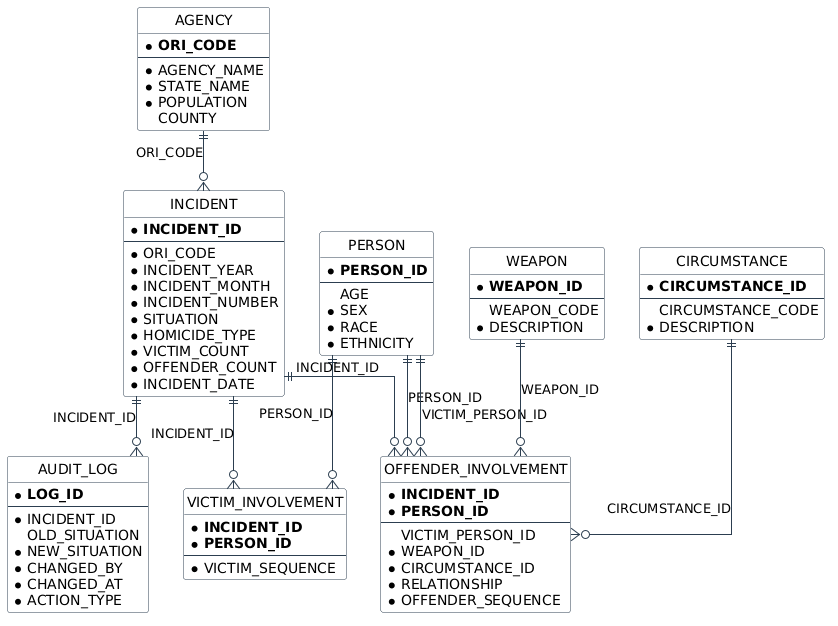

---

## 2. SQL-Abfragen (Kapitel 2.5)

### 2.1 Abfrage 1: Vergleich Tötungsdelikte und Gesamtopferzahlen (1985 vs. 2025)
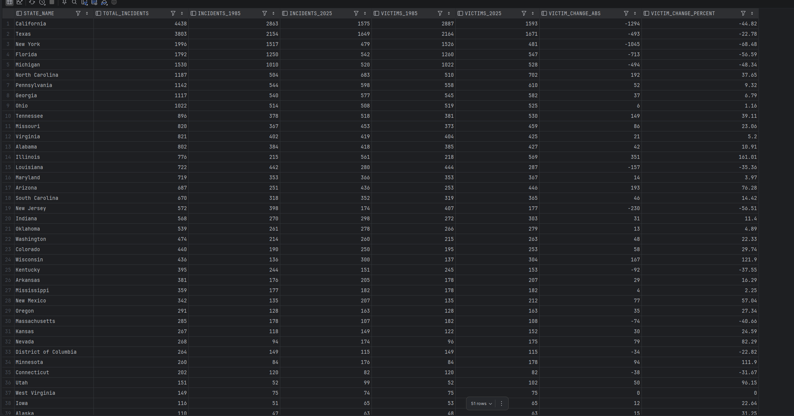

### 2.2 Abfrage 2: Top 5 Tatwaffen bei Beziehungstaten in Staaten mit hoher Fallzahl
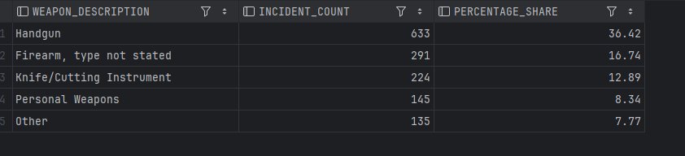

### 2.3 Abfrage 3: Polizeibehörden mit überdurchschnittlich vielen ungelösten Fällen
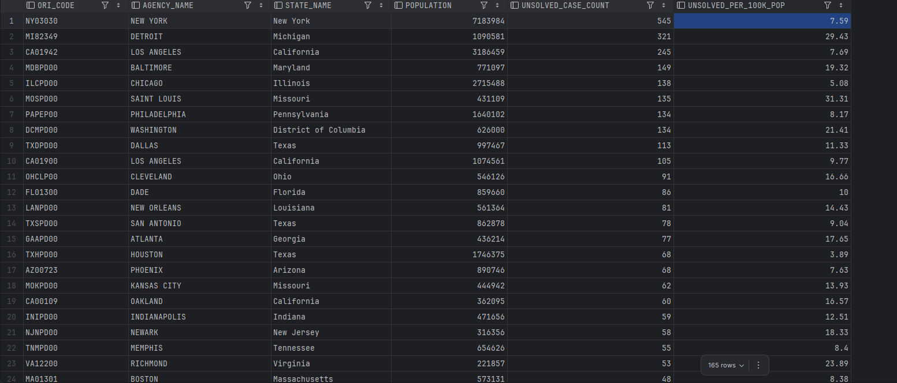

---

## 3. Data Dictionary Abfragen (Kapitel 2.5)

### 3.1 Alle Tabellen und Spaltenanzahl
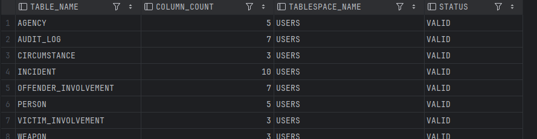

### 3.2 Spalten, Datentypen und Constraints für Tabelle INCIDENT

**Spalten und Datentypen:**  
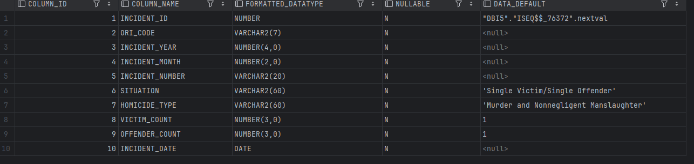

**Constraints:**  
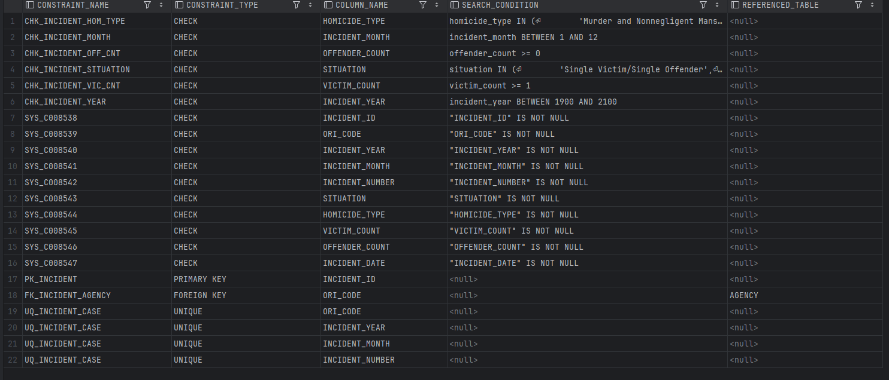

### 3.3 Berechtigungen von Rollen und Benutzern

**Berechtigungen der Rolle DataAnalyst:**  
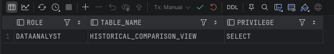

**Rechte von Benutzer PublicViewer:**  
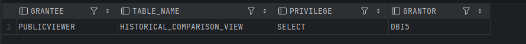

**Rollenzuweisung an Benutzer Investigator:**  

---

## 4. Trigger (Kapitel 2.6)

### 4.1 Before-Insert-Trigger: Altersvalidierung (0–120 Jahre)
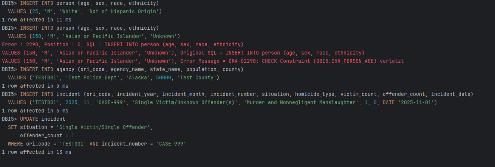

### 4.2 After-Update-Trigger: Audit-Log bei Statusänderung
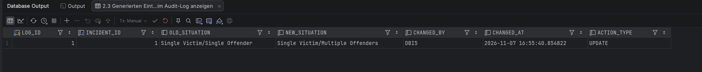

---

## 5. View (Kapitel 2.7)

### Historical_Comparison_View
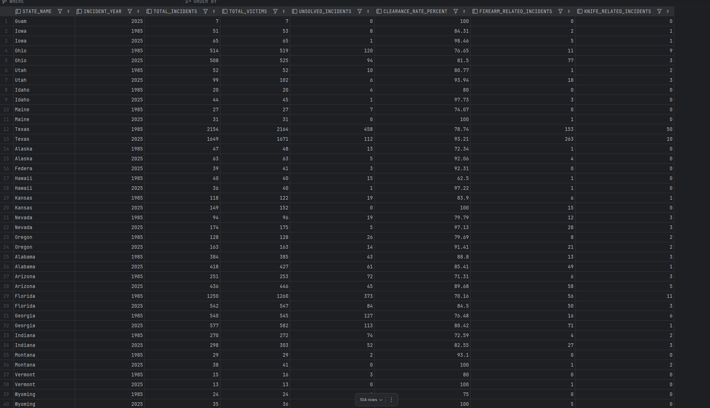
