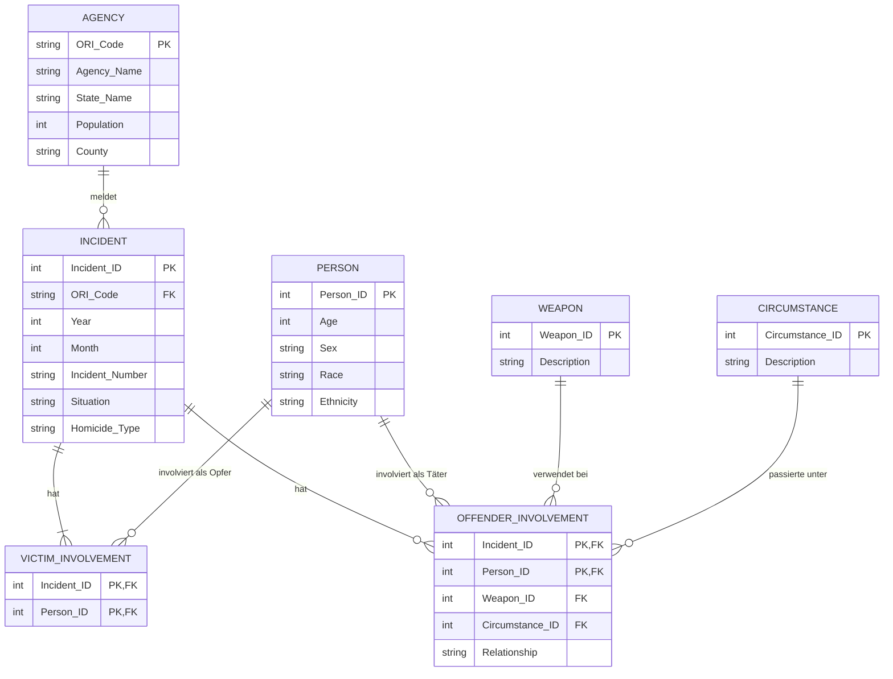

# Exposé: Datenbankprojekt "US Homicides (SHR)"

## Domänendefinition

**Worum geht es?**
Die Datenbank verwaltet und strukturiert Daten zu Tötungsdelikten (Homicides) in den USA. Die Grundlage bilden die "Supplementary Homicide Reports" (SHR) des FBI, welche Informationen über Vorfälle, beteiligte Polizeibehörden sowie Täter und Opfer beinhalten. 

**Für wen oder für welche Anwendung soll die Datenbank sein?**
Die Datenbank richtet sich an Kriminologen, Soziologen, Strafverfolgungsbehörden und Journalisten. Sie ermöglicht statistische Analysen (z.B. Trends über Zeiträume, verwendete Waffen, Täter-Opfer-Beziehungen, Aufklärungsraten nach Bundesstaaten).

**Welche Daten sollen gespeichert werden?**
* **Behörden (Agencies):** Name, Bundesstaat, Bevölkerungsgröße (Population), Kennungen (ORI Code).
* **Vorfälle (Incidents):** Jahr, Monat, Art des Delikts, Situation (z.B. "Single Victim/Single Offender").
* **Personen (als Opfer oder Täter):** Alter, Geschlecht, Rasse, ethnische Zugehörigkeit.
* **Tatdetails:** Verwendete Waffen, Umstände (Circumstances) und die Beziehung zwischen Täter und Opfer.

**Welche Daten werden NICHT gespeichert?**
Aus Datenschutzgründen werden **keine identifizierenden personenbezogenen Daten** (wie echte Namen, exakte Adressen, Sozialversicherungsnummern) gespeichert. Personen werden rein als demografische Profile erfasst.

---

## Modellierung (ERD)

Um die denormalisierten CSV-Daten sinnvoll abzubilden, werden mindestens 5 Tabellen und mehrere m:n-Beziehungen definiert (z.B. können bei einem Vorfall mehrere Täter und Opfer beteiligt sein).

*Die m:n-Beziehungen ergeben sich hier zwischen `INCIDENT` und `PERSON` (einmal als Opfer via `VICTIM_INVOLVEMENT`, einmal als Täter via `OFFENDER_INVOLVEMENT`).*

---

## Geplante SQL-Abfragen (Textuelle Beschreibung)

**3 komplexe Abfragen (mit JOIN, GROUP BY, AVG, SUM, COUNT, ORDER BY, Subqueries):**

1. **Gefährlichste Bundesstaaten und Opferprofil:**
   Zeigt die Gesamtzahl der Tötungsdelikte und das durchschnittliche Alter der Opfer pro Bundesstaat an. Die Ausgabe wird nach der Anzahl der Vorfälle absteigend sortiert.
   *(Enthält: JOIN über Agency, Incident, Victim_Involvement und Person, GROUP BY State, COUNT, AVG, ORDER BY)*
2. **Häufigste Waffen bei Beziehungstaten:**
   Ermittelt die Top 5 der am häufigsten verwendeten Waffen bei Vorfällen, in denen der Täter das Opfer kannte (Relationship ungleich 'Stranger' oder 'Unknown').
   *(Enthält: JOIN über Weapon und Offender_Involvement, GROUP BY Waffe, COUNT, ORDER BY DESC, LIMIT/FETCH FIRST)*
3. **Behörden mit überdurchschnittlich vielen ungelösten Fällen:**
   Listet alle Polizeibehörden auf, bei denen die Anzahl der ungelösten Vorfälle (z.B. Täter ist "Unknown") größer ist als der Durchschnitt der ungelösten Fälle über alle Behörden hinweg.
   *(Enthält: Subquery mit AVG und COUNT, JOIN, GROUP BY, HAVING)*

**3 Abfragen an das Data Dictionary:**
1. Ausgabe aller von uns erstellten Tabellen sowie der jeweiligen Anzahl an Spalten.
2. Ausgabe aller Constraints (Primary Keys, Foreign Keys, Check-Constraints), Datentypen und maximalen Längen pro Spalte für die Tabelle `INCIDENT`.
3. Ausgabe der vergebenen System- und Objektberechtigungen für die Rolle `DataAnalyst` sowie für den Benutzer `PublicViewer`.

---

## Geplante Trigger (Textuelle Beschreibung)

1. **Before-Insert-Trigger (Datenvalidierung):**
   Dieser Trigger feuert, bevor eine neue `PERSON` in die Datenbank eingefügt wird. Er überprüft, ob das Alter der Person in einem realistischen Bereich liegt (z.B. >= 0 und <= 120 oder ein spezieller Wert für "Unbekannt"). Ist das Alter unplausibel, wird der Insert mit einer aussagekräftigen Fehlermeldung abgebrochen.
2. **After-Update-Trigger (Auditing/Logging):**
   Dieser Trigger überwacht die Tabelle `INCIDENT`. Wenn sich der Aufklärungsstatus eines Falles ändert (z.B. ändert sich die `Situation` von "Single Victim/Unknown Offender" zu "Single Victim/Single Offender"), schreibt der Trigger automatisch einen Eintrag in eine Tabelle `AUDIT_LOG`. Gespeichert werden dabei die alte und neue Situation, das Datum der Änderung sowie der ausführende Benutzer.

---

## Geplante Benutzerrechte & Views (Textuelle Beschreibung)

**Benutzer und Rollen:**
1. **Rolle `DataAnalyst`**: Hat umfassende Leserechte (SELECT) auf alle Tabellen, darf aber keine operativen Daten verändern.
2. **Benutzer `AdminUser`**: Besitzt alle Rechte (SELECT, INSERT, UPDATE, DELETE, CREATE) auf alle Tabellen und Views. Er ist für die Verwaltung der Datenbankstruktur und Datenbereinigung zuständig.
3. **Benutzer `Investigator`**: Ihm wird die Rolle `DataAnalyst` zugewiesen. Er kann somit auf die gesamten Datensätze lesend zugreifen, um Ermittlungen statistisch zu untermauern.
4. **Benutzer `PublicViewer`**: Hat stark eingeschränkte Rechte. Er darf keine direkten Tabellen abfragen, sondern hat **nur Leserecht auf eine bestimmte View**.

**Geplante View:**
* **`Public_Incident_Overview`**: Diese View verknüpft `INCIDENT`, `AGENCY` und `WEAPON`. Sie zeigt lediglich aggregierte oder anonymisierte Daten an (Jahr, Monat, Bundesstaat, Art der Waffe). Details zu den beteiligten Personen (Alter, Geschlecht, Ethnie) werden bewusst weggelassen, um die Übersicht für die breite Öffentlichkeit sicher bereitzustellen.
