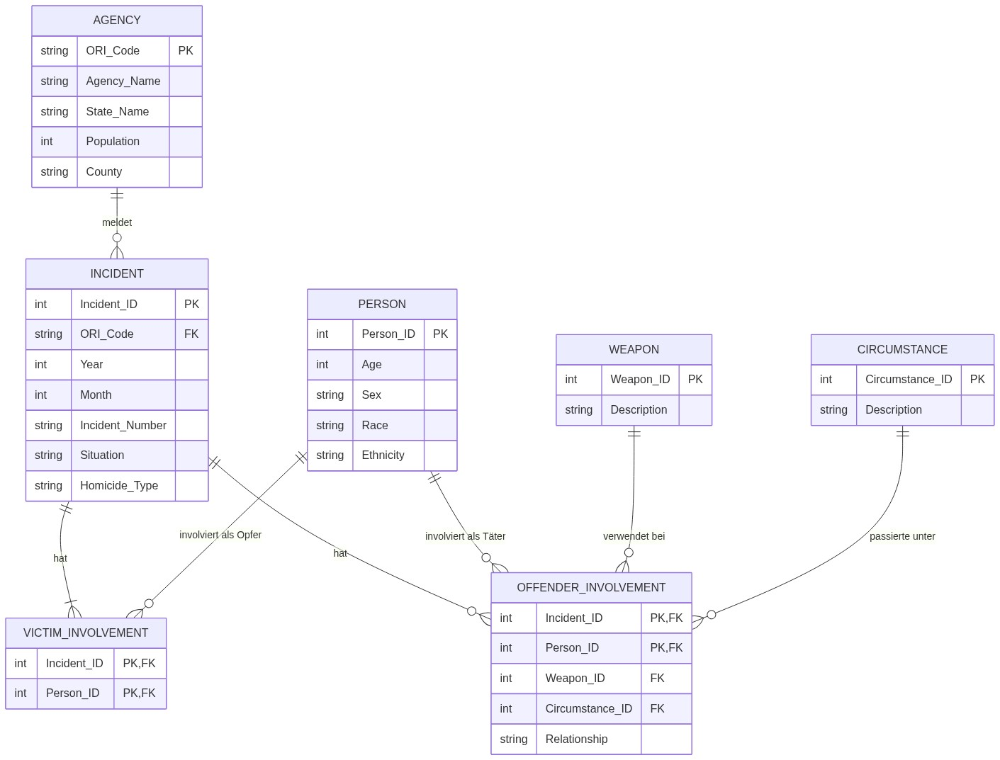

# Exposé: Datenbankprojekt "US Homicides (SHR)"

## Domänendefinition

Verwaltung und Strukturierung von Daten zu Tötungsdelikten in den USA basierend auf den Supplementary Homicide Reports (SHR) des FBI (Erhebungsjahre 1980 und 2025, Haupttabelle mit über 20.000 Datensätzen). Die Datenbank richtet sich an Kriminologen, Strafverfolgungsbehörden und Journalisten zur statistischen Analyse von Kriminalitätsentwicklungen.

**Gespeicherte Daten:**

* **Behörde / Agency:** ORI-Code, Name, Bundesstaat, Population, County
* **Vorfall / Incident:** ID, Jahr, Monat, Aktenzeichen, Situation, Deliktart
* **Person:** ID, Alter, Geschlecht, Rasse, Ethnie
* **Waffe:** ID, Beschreibung
* **Tatumstand / Circumstance:** ID, Beschreibung
* **Opfer-Beteiligung:** Vorfall, Person (m:n-Zuordnung)
* **Täter-Beteiligung:** Vorfall, Person, Waffe, Tatumstand, Beziehung zum Opfer (m:n-Zuordnung)

**Nicht gespeicherte Daten:**  
Aus Datenschutzgründen werden keine identifizierenden personenbezogenen Klardaten (wie reale Namen, Wohnadressen oder Sozialversicherungsnummern) erfasst.

## Modellierung (ERD)

## SQL-Abfragen

* Vergleich der Tötungsdelikte und Gesamtopferzahlen pro Bundesstaat zwischen 1980 und 2025
* Die 5 häufigsten Tatwaffen bei Beziehungstaten in Bundesstaaten mit hoher Fallzahl
* Polizeibehörden mit überdurchschnittlich vielen ungelösten Fällen
* **Data Dictionary:** Ausgabe aller Tabellen und deren Spaltenanzahl
* **Data Dictionary:** Constraints, Datentypen und Längen für die Tabelle `INCIDENT`
* **Data Dictionary:** Berechtigungen der Rolle `DataAnalyst` und des Benutzers `PublicViewer`

## Trigger

* **Before-Insert-Trigger:** Überprüfung auf ein plausibles Alter (0–120 Jahre) vor dem Einfügen einer neuen Person.
* **After-Update-Trigger:** Automatischer Logeintrag in `AUDIT_LOG`, wenn sich die Aufklärungssituation (`Situation`) eines Vorfalls ändert.

## Benutzerrechte & Views

* **Rolle `DataAnalyst`:** Leserechte auf alle Tabellen zur statistischen Auswertung.
* **Benutzer `Investigator`:** Zugewiesene Rolle `DataAnalyst`.
* **Benutzer `AdminUser`:** Vollzugriff (Lesen, Schreiben, DDL) auf alle Tabellen und Views.
* **Benutzer `PublicViewer`:** Leserechte nur auf Stammdaten (`AGENCY`, `WEAPON`) sowie auf die View.
* **View `Historical_Comparison_View`:** Verknüpft Vorfälle, Behörden und Waffen zur anonymisierten Gegenüberstellung von Kriminalitätsstatistiken der Jahre 1980 und 2025.
